# Fan360 — Motorsport Fan Data & Audience Segmentation Platform

[](https://www.python.org/)
[](https://spark.apache.org/)
[](https://www.postgresql.org/)
[](https://fastapi.tiangolo.com/)
[](tests/)

> **Educational Portfolio Project**: Built to demonstrate core competencies in Python, PySpark, SQL, data modeling, automated data quality, REST API design, testing, and translating business requirements into robust technical solutions.
>
> All achievements and metrics reported in this project adhere strictly to the Google **“Accomplished [X], measured by [Y], by doing [Z]”** formula, supported by reproducible automated test runs and benchmark evidence files.

---

## Context and Boundaries
- **Fictional Context**: Inspired by customer-data challenges in motorsport fan engagement. Built for the fictional racing team **Apex Velocity Racing** featuring fictional drivers (*Elena Vance*, *Marcus Lindholm*, *Sofia Al-Mansoor*, *Lucas Rossi*) and 100% synthetic audience data.
- **Independent Project**: This is an independent educational engineering project. It is **not** affiliated with or sponsored by Formula One, Alpine, or Adobe.
- **Architecture Scope**: This platform executes on-demand and scheduled **batch processing**. It does not claim real-time streaming or enterprise CDP certification.

---

## System Architecture

```mermaid
flowchart LR
    subgraph Sources["Raw Synthetic Data"]
        F["fans.csv"]
        O["orders.csv"]
        W["web_events.csv"]
        E["email_events.csv"]
        C["consent.csv"]
    end

    subgraph Pipeline["Ingestion & Quality Subsystem"]
        VAL["DataValidator"]
        QUAR["Quarantine Store (Reason Codes)"]
        DEDUP["Deduplication Engine"]
    end

    subgraph Transformation["PySpark Engine"]
        PROF["Consolidated Profiles"]
        SEG["Audience Segments (5 Rules)"]
        CONSENT["Latest-Effective Consent Resolution"]
    end

    subgraph Storage["PostgreSQL 16"]
        DB_PROF[("fan_profiles")]
        DB_MEM[("fan_segment_memberships")]
        DB_ACT[("activation_audiences")]
        DB_RUNS[("pipeline_runs")]
    end

    subgraph Serving["Consumption Layer"]
        API["FastAPI REST API (:8000)"]
        UI["Streamlit Dashboard (:8501)"]
    end

    Sources --> VAL
    VAL --> QUAR
    VAL --> DEDUP --> Transformation
    Transformation --> Storage
    Storage --> Serving
```



---

## Key Features

1. **Deterministic Synthetic Data Generator**: Generates 10,000+ fans and 100,000+ events with configurable seeds, timestamps, and labeled defect injection tracking.
2. **Data Quality & Quarantine Engine**: Hierarchical validation isolating missing IDs, unknown foreign keys, invalid dates, negative amounts, and bad consent statuses without double-counting.
3. **PySpark Fan 360 Aggregations**: Consolidated lifetime spend in USD, order counts, and last activity timestamps across heterogeneous streams.
4. **Behavioral Audience Segmentation**:
   - **Engaged Non-Buyers**: Activity in past 90 days with 0 completed purchases.
   - **Repeat Buyers**: $\ge 2$ valid completed merchandise orders.
   - **High-Spending Buyers**: $\ge \$250.00$ USD in valid merchandise spend.
   - **Inactive Fans**: No activity within the past 180 days.
   - **Abandoned Cart**: Unresolved `add_to_cart` event within 14 days without a matching completed order.
5. **Strict Consent Governance**: Latest-effective-update resolution with deterministic tie-breaking. 100% exclusion of non-consenting fans from marketing activations.
6. **Idempotent Storage**: PostgreSQL tables with stable primary keys ensuring 0 duplicate rows across consecutive runs.
7. **REST API & Dashboard**: OpenAPI-documented FastAPI endpoints and an interactive Streamlit UI.

---

## Quickstart & Commands

### Prerequisites
- Python 3.11+
- Java (OpenJDK 17 or compatible; OpenJDK 25 LTS verified in local environment)
- PostgreSQL 16 (running locally on port 5432 or via Docker)

### 1. Environment Setup
```bash
# Create and activate virtual environment
python3 -m venv .venv
source .venv/bin/activate

# Install pinned dependencies
pip install -r requirements.txt
```

### 2. Generate Synthetic Data
```bash
# Generate 10k fans and 100k events with 2% defect injection
python scripts/generate_data.py --fans 10000 --events 100000 --seed 42 --error-rate 0.02 --out-dir data/raw
```

### 3. Run the Data Pipeline
```bash
# Execute ingestion, PySpark transformation, database loading, and reconciliation audit
python scripts/run_pipeline.py --data-dir data/raw --dataset-name demo_10k
```

### 4. Run Automated Tests
```bash
# Execute 17 automated tests and generate JUnit XML
pytest -v --junitxml=artifacts/test-results.xml tests/
```

### 5. Run Automated Benchmarks & Evidence Collection
```bash
# Measure precision/recall, idempotency hashes, latency, and generate evidence
python scripts/run_benchmarks.py
```

### 6. Launch Applications
```bash
# Start FastAPI REST API (http://127.0.0.1:8000/docs)
uvicorn src.api.app:app --host 127.0.0.1 --port 8000 --reload

# Start Streamlit Demonstration Dashboard (http://localhost:8501)
streamlit run src/ui/dashboard.py
```

### 7. Run with Docker Compose (Alternative)
```bash
docker compose up -d
```

---

## Verifiable Résumé Achievements (XYZ Format)

Every bullet is backed by real execution artifacts in [`artifacts/resume-evidence.md`](artifacts/resume-evidence.md):

1. **Consolidated 110,624 multi-channel synthetic customer records across 5 sources into 10,000 unified fan profiles, achieving 100% mathematical reconciliation (109,944 accepted, 431 quarantined, 249 deduplicated) and zero duplicate records across reruns, by developing an idempotent PySpark transformation pipeline with hierarchical schema validation.**
2. **Engineered an automated data quality and quarantine subsystem that intercepted and triaged synthetic data defects with 99.6% deduplication recall, 100% timestamp/amount recall, and zero double-counting across multi-defect records, by designing a prioritized validation hierarchy enforcing structural, temporal, and referential constraints.**
3. **Architected an audience segmentation engine generating 8,092 descriptive segment qualifications across 5 behavioral rules with 100% exact match against golden fixtures, while strictly excluding 100% of non-consenting fans from marketing activations (0 non-consenting fans in 4,831 exports), by implementing time-windowed cart abandonment and deterministic latest-effective consent resolution.**

---

## Project Documentation Index

- [`PLAN.md`](PLAN.md): Implementation milestone roadmap and acceptance checklist.
- [`docs/business-requirements.md`](docs/business-requirements.md): Business scenario, requirements matrix, and scope boundaries.
- [`docs/architecture.md`](docs/architecture.md): Architectural design, data flow diagrams, and design trade-offs.
- [`docs/data-dictionary.md`](docs/data-dictionary.md): Field-level definitions for all source and persistent PostgreSQL tables.
- [`docs/segment-rules.md`](docs/segment-rules.md): Explicit qualification criteria, time windows, and boundary logic for all 5 segments.
- [`docs/testing-and-benchmarks.md`](docs/testing-and-benchmarks.md): Guide to automated tests, baseline comparisons, and evidence generation.
- [`docs/troubleshooting.md`](docs/troubleshooting.md): Diagnostic runbook and step-by-step resolution of data issues.
- [`docs/demo-script.md`](docs/demo-script.md): Two-minute presentation script and walkthrough.
- [`docs/interview-preparation.md`](docs/interview-preparation.md): Key technical concepts and defense of architectural trade-offs.
- [`docs/resume-bullets.md`](docs/resume-bullets.md): Complete XYZ résumé bullets with links to machine-readable evidence.
