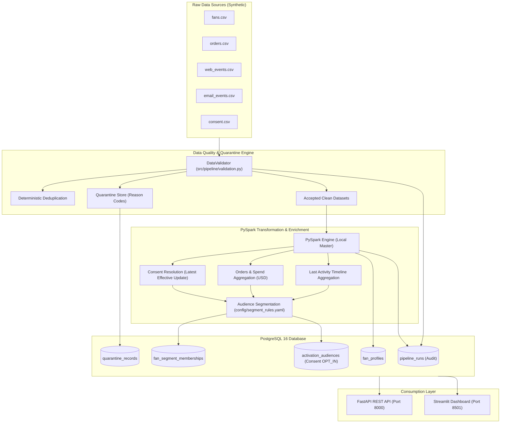

# System Architecture & Technical Design
## Fan360 — Motorsport Fan Data & Audience Segmentation Platform

---

## 1. Architectural Highlights & Design Patterns

### A. Separation of Raw Ingestion, Validation, and Processing
Raw CSV files are ingested without modifying source state. The `DataValidator` evaluates records before PySpark transformation, ensuring that downstream transformations receive only valid schema-conforming records while defect data is preserved in `quarantine_records` for analysis.

### B. Hierarchical Defect Triage (Zero Double-Counting)
When an input row violates multiple rules (e.g. missing fan ID and invalid timestamp), the validator assigns the highest priority reason code:
1. `MISSING_REQUIRED_FIELD` (Structural prerequisite)
2. `UNKNOWN_FAN_REFERENCE` (Referential integrity against valid fans)
3. `INVALID_TIMESTAMP` (Temporal validity up to as-of timestamp)
4. `INVALID_ORDER_AMOUNT` (Domain boundary: amount > 0)
5. `INVALID_CONSENT_STATUS` (Enum: OPT_IN / OPT_OUT)

This hierarchy guarantees strict input reconciliation:
$$\text{Raw Rows} = \text{Accepted Rows} + \text{Quarantined Rows} + \text{Duplicates Removed}$$

### C. Latest-Effective-Update Consent Resolution
Fan consent changes over time. To avoid race conditions:
- Updates are filtered up to `as_of_timestamp`.
- Sorted by `update_timestamp DESC, consent_id DESC`.
- The top record determines current consent.
- Fans with no consent records default to `NONE`.
- Marketing activation views strictly filter for `OPT_IN`. Missing or ambiguous consent strictly denies activation eligibility.

### D. Idempotent Storage Architecture
All persistent tables feature deterministic primary or composite keys:
- `fan_profiles`: `PRIMARY KEY (fan_id)`
- `fan_segment_memberships`: `PRIMARY KEY (fan_id, segment_code)`
- `activation_audiences`: `PRIMARY KEY (fan_id, segment_code, last_run_id)`
- `pipeline_runs`: `PRIMARY KEY (run_id)`

PostgreSQL `ON CONFLICT DO UPDATE` guarantees that re-running the pipeline on unchanged data leaves database row counts and logical states identical.
