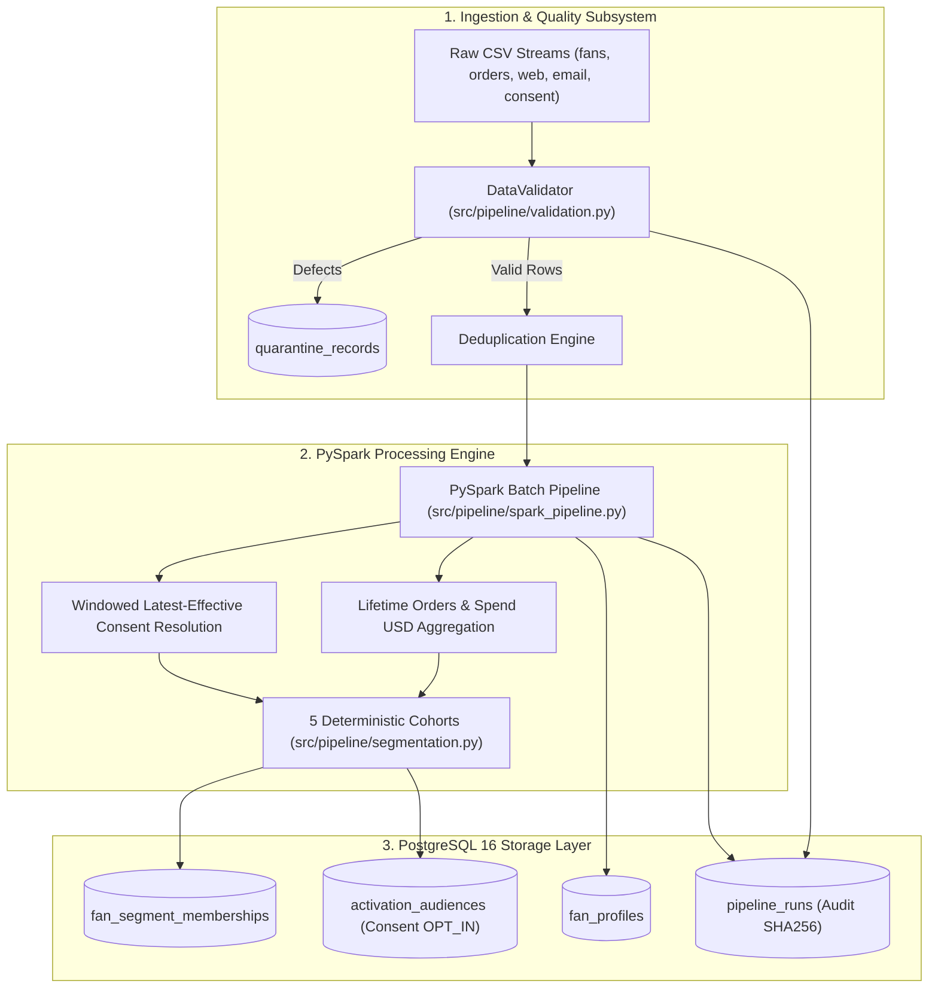
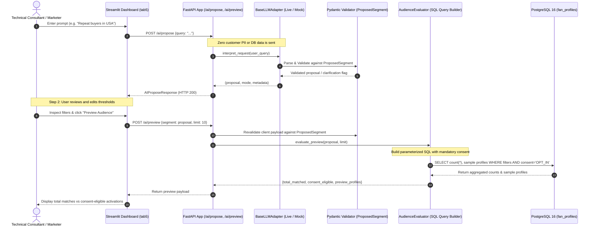

# System Architecture & Technical Design
## Fan360 — Motorsport Fan Data & AI Audience Platform

> **Scope & Educational Context**: Fan360 is an educational engineering portfolio project demonstrating enterprise data pipeline design, PySpark distributed aggregations, data quality quarantining, and an AI-assisted audience requirement interpreter.
> 
> It is an independent portfolio project and is **not** an official Adobe Experience Platform (AEP) or Real-Time CDP implementation.

---

## 1. End-to-End System Flow

---

## 2. AI-Assisted Audience Requirement Interpreter Architecture

The audience interpreter enables users to translate natural-language requirements into verified, consent-safe audience previews without writing SQL or exposing customer databases to an LLM.

### 2.1 Request Lifecycle Flow

---

## 3. Architecture Decision Records (ADRs)

### ADR-1: Proposing Structured Filters Rather Than Raw SQL
- **Context**: LLMs can generate raw SQL, but raw SQL generated by an LLM poses critical security and reliability vulnerabilities (SQL injection, schema hallucination, unconstrained joins, and non-deterministic execution).
- **Decision**: The LLM is restricted to proposing structured JSON conforming to [`ProposedSegment`](file:///Users/tejashr/Downloads/adobe/src/ai/schema.py#L168) containing allowlisted fields, operators, and typed arguments.
- **Consequence**: The LLM acts purely as a semantic translator. Execution is handed off to deterministic application code, completely preventing SQL injection.

### ADR-2: Untrusted Model Output & Strict Allowlist Boundaries
- **Context**: LLM output is non-deterministic and can generate hallucinated attributes (e.g. `credit_score`, `age`, `net_worth`) or unsupported operators (`LIKE`, `REGEX`).
- **Decision**: In [`src/ai/schema.py`](file:///Users/tejashr/Downloads/adobe/src/ai/schema.py#L15), every filter is validated against `ALLOWLISTED_FIELDS`. Unknown attributes, invalid types, or extra properties are immediately rejected via `extra="forbid"`.
- **Consequence**: Only pre-approved database columns derived directly from the application schema can ever be queried.

### ADR-3: Preview-Time Revalidation Against Client-Side Tampering
- **Context**: After the proposal is rendered in the UI, an attacker or compromised client could modify the payload sent to `POST /ai/preview` to bypass validation.
- **Decision**: In [`src/api/app.py`](file:///Users/tejashr/Downloads/adobe/src/api/app.py#L400), the incoming segment in `AIPreviewRequest` is re-validated through Pydantic's `ProposedSegment` before reaching the query generator.
- **Consequence**: Guarantees that manually tampered JSON payloads cannot inject arbitrary operators or unallowlisted fields.

### ADR-4: Inert SQL Parameterization
- **Context**: Attribute filter values (such as strings or names) could contain SQL syntax fragments (e.g. `Lucas'; DROP TABLE fan_profiles; --`).
- **Decision**: In [`AudienceEvaluator._build_query()`](file:///Users/tejashr/Downloads/adobe/src/ai/evaluator.py#L38), all filter values are passed as positional parameters (`%s` placeholders in `psycopg2`).
- **Consequence**: Values are escaped and bound as inert literals by the PostgreSQL client driver. Direct string concatenation of filter values is strictly prohibited.

### ADR-5: Mandatory Marketing Consent Segregation
- **Context**: In enterprise customer marketing (GDPR, CCPA), targeting criteria (e.g., fans with 2 orders) must never override customer communication preferences. If an LLM is asked to *"export everyone without consent"*, the system must remain consent-safe.
- **Decision**: Consent is **not** an attribute filter that the LLM decides. In [`AudienceEvaluator.evaluate_preview()`](file:///Users/tejashr/Downloads/adobe/src/ai/evaluator.py#L65), the SQL query calculates:
  1. `total_matched`: Total profiles satisfying behavioral filters.
  2. `consent_eligible`: Total profiles satisfying behavioral filters **AND** `marketing_consent_status = 'OPT_IN'`.
- **Consequence**: Non-consenting fans are mathematically excluded from activation lists, regardless of the user's natural language prompt.

### ADR-6: Provider Strategy & Zero-Silent-Fallback Enforcement
- **Context**: Silent fallback from a live model to a mock provider masks configuration errors, outages, or expired API keys, creating false confidence in test and production runs.
- **Decision**: In [`src/ai/provider.py`](file:///Users/tejashr/Downloads/adobe/src/ai/provider.py#L475), the `get_llm_adapter()` factory enforces explicit modes (`LLM_MODE=mock` or `LLM_MODE=live`). If `live` mode is requested and `LLM_API_KEY` is missing, it raises [`ConfigurationError`](file:///Users/tejashr/Downloads/adobe/src/ai/provider.py#L32) and maps to HTTP 503.
- **Consequence**: Zero silent fallbacks. Operational failures are transparently surfaced.

### ADR-7: Zero Customer Data Transmission (Privacy Boundary)
- **Context**: Enterprise privacy rules prohibit transmitting customer PII, raw records, or customer IDs to third-party LLM providers.
- **Decision**: The system prompt and user message sent to the LLM contain **only** the allowable schema definitions and the user's prompt string. Zero database rows, profile records, or connection strings are ever sent over the network.
- **Consequence**: Full privacy preservation by design.

### ADR-8: Domain Error Taxonomy & Propagation
- **Context**: Upstream provider failures (HTTP 401, 429, timeouts, malformed JSON) must be translated into actionable operational feedback rather than opaque internal server errors (HTTP 500).
- **Decision**: Custom domain exceptions ([`AuthenticationError`](file:///Users/tejashr/Downloads/adobe/src/ai/provider.py#L37), [`RateLimitError`](file:///Users/tejashr/Downloads/adobe/src/ai/provider.py#L42), [`ProviderTimeoutError`](file:///Users/tejashr/Downloads/adobe/src/ai/provider.py#L52), [`ProviderPayloadError`](file:///Users/tejashr/Downloads/adobe/src/ai/provider.py#L57)) are caught in FastAPI and mapped to HTTP 502 Bad Gateway with diagnostic error details.
- **Consequence**: Clean operational visibility in logs and UI.
