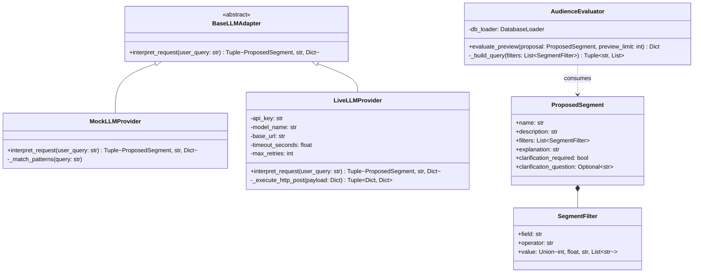

# Code Walkthrough: OOP, Design Patterns & Algorithms
## Technical Architecture & Implementation Details

> **Educational Portfolio Context**: This document provides an honest, technical explanation of object-oriented design, architectural patterns, and computational complexity implemented in **Fan360**.
> 
> Concepts are documented as actually implemented in source code without exaggerating pattern usage or inventing enterprise complexities.

---

## 1. Class Responsibilities & Interfaces



### 1.1 Interface Contracts
- **[`BaseLLMAdapter`](file:///Users/tejashr/Downloads/adobe/src/ai/provider.py#L91)**: Abstract base class defining the contract for requirement interpretation. Every provider must return a three-element tuple: `(proposal: ProposedSegment, provider_mode: str, metadata: Dict[str, Any])`.
- **[`MockLLMProvider`](file:///Users/tejashr/Downloads/adobe/src/ai/provider.py#L102)**: Local implementation using regex heuristics. Executes in $< 1\text{ ms}$ without internet connectivity or credentials. Labeled explicitly as `"Mock LLM — not a live model"`.
- **[`LiveLLMProvider`](file:///Users/tejashr/Downloads/adobe/src/ai/provider.py#L283)**: Production-style HTTP client interfacing with OpenAI-compatible endpoints (Groq, Google AI Studio, OpenAI, or local Ollama). Handles JSON-schema payload packaging, transient retries, token usage extraction, and error classification.
- **[`ProposedSegment`](file:///Users/tejashr/Downloads/adobe/src/ai/schema.py#L168)** & **[`SegmentFilter`](file:///Users/tejashr/Downloads/adobe/src/ai/schema.py#L60)**: Pydantic models enforcing schema immutability, type casting, operator allowlists, and numeric boundary constraints.
- **[`AudienceEvaluator`](file:///Users/tejashr/Downloads/adobe/src/ai/evaluator.py#L14)**: Database execution service encapsulating parameterized SQL query generation and consent segregation.

---

## 2. Encapsulation & Polymorphism in Practice

### 2.1 Encapsulation
- **Query Construction Privacy**: In `AudienceEvaluator`, the method `_build_query()` is private. External callers (`FastAPI` route handlers or evaluation scripts) never touch raw SQL syntax or handle parameter tuples directly. Callers provide a `ProposedSegment` object and receive structured result dictionaries.
- **Credential & Header Isolation**: `LiveLLMProvider` encapsulates HTTP authorization headers, JSON encoding, and retry loops inside `_execute_http_post()`. Callers simply invoke `adapter.interpret_request(user_prompt)`.

### 2.2 Polymorphism
- The application consumer in [`src/api/app.py`](file:///Users/tejashr/Downloads/adobe/src/api/app.py#L383) interacts solely with the abstract `BaseLLMAdapter` interface:
  ```python
  adapter: BaseLLMAdapter = get_llm_adapter()
  proposal, mode, metadata = adapter.interpret_request(req.query)
  ```
  The endpoint behavior remains identical whether `MockLLMProvider` or `LiveLLMProvider` is returned by the factory, demonstrating genuine polymorphic substitution (Liskov Substitution Principle).

---

## 3. Design Pattern Analysis: Adapter vs. Strategy

The architecture employs a hybrid of the **Adapter** and **Strategy** design patterns:

### Why It Fits the Adapter Pattern
An **Adapter** converts the interface of a class/service into another interface that clients expect.
- The external LLM endpoint speaks raw HTTP REST with nested JSON payloads (`choices[0].message.content`).
- The internal application expects a domain-specific `ProposedSegment` model and timing metadata.
- `LiveLLMProvider` acts as an object adapter, translating foreign HTTP JSON responses into internal Pydantic models while adapting network exceptions into domain exceptions (`RateLimitError`, `ProviderTimeoutError`).

### Why It Fits the Strategy Pattern
A **Strategy** defines a family of algorithms, encapsulates each one, and makes them interchangeable at runtime.
- The system offers two interchangeable strategies for requirement interpretation:
  1. `MockLLMProvider`: Deterministic regex parsing algorithm (0 latency, offline).
  2. `LiveLLMProvider`: Cloud LLM inference strategy (network-bound, semantic reasoning).
- The client selects the strategy dynamically via the `LLM_MODE` environment variable without altering application flow.

---

## 4. Algorithms & Computational Complexity

### 4.1 Parameterized SQL Query Builder (`AudienceEvaluator._build_query`)

```python
# Mapped in src/ai/evaluator.py
def _build_query(self, filters: List[SegmentFilter]) -> Tuple[str, List[Any]]:
    clauses = ["1=1"]
    params = []
    for flt in filters:
        op = "=" if flt.operator == "==" else flt.operator
        clauses.append(f"{flt.field} {op} %s")
        params.append(flt.value)
    return " AND ".join(clauses), params
```

#### Complexity Analysis:
- **Time Complexity**: $\mathcal{O}(F)$, where $F$ is the number of filters. Since $F \le 5$ (enforced by Pydantic `max_length=5`), query building takes $< 0.05\text{ ms}$ (effectively $\mathcal{O}(1)$).
- **Space Complexity**: $\mathcal{O}(F)$ to allocate the SQL string and parameter list.
- **Database Execution Complexity**: In PostgreSQL, query execution over $N = 10,000$ profiles:
  - Without an index: Linear table scan $\mathcal{O}(N)$.
  - With B-Tree indexes on `total_valid_spend` and `valid_completed_order_count`: Range scan $\mathcal{O}(\log N + K)$, where $K$ is the number of matched rows.

#### Assumptions & Limitations:
- Assumes conjunctive `AND` logic only.
- Assumes allowlisted fields map 1:1 to indexed columns in `fan_profiles`.

---

### 4.2 Distributed PySpark Windowing vs. Local Complexity

In `src/pipeline/spark_pipeline.py`, marketing consent is resolved using the latest effective update:

```python
window_spec = Window.partitionBy("fan_id").orderBy(
    col("update_timestamp").desc(),
    col("consent_id").desc()
)
resolved_df = consent_df.withColumn("row_num", row_number().over(window_spec)) \
                        .filter(col("row_num") == 1)
```

#### Local vs. Distributed Complexity Breakdown:

1. **Local In-Memory Complexity (Single Partition)**:
   - Within each partition, sorting $K$ consent records for a single fan takes $\mathcal{O}(K \log K)$ time.
   - Filtering the top record takes $\mathcal{O}(1)$ space per fan.

2. **Distributed Cluster Costs (The Real Bottleneck)**:
   - **Shuffle & Partitioning Cost**: To evaluate `partitionBy("fan_id")`, PySpark must hash `fan_id` and exchange records across executor nodes over the network.
   - **Network I/O**: If there are $M$ raw consent events, $M$ records are serialized, transmitted across cluster nodes, and spilled to disk if partition memory is exceeded.
   - **Data Skew**: If a popular fan has 10,000 updates while others have 1, the executor handling that fan's partition becomes a straggler, dictating the total job completion time.
